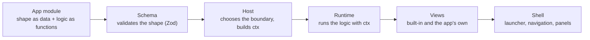
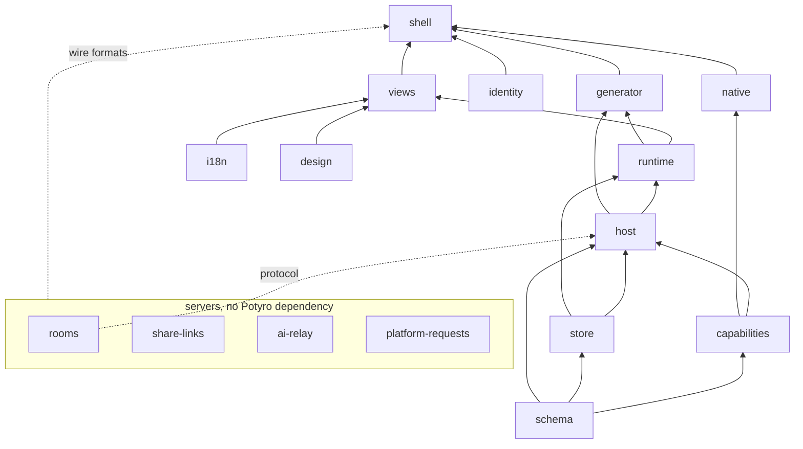
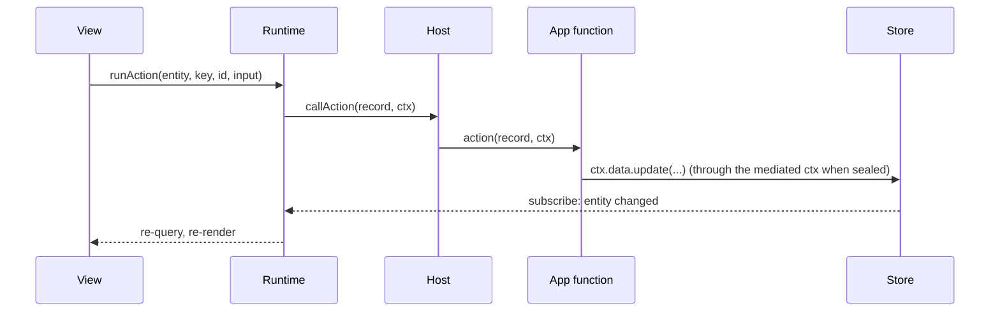
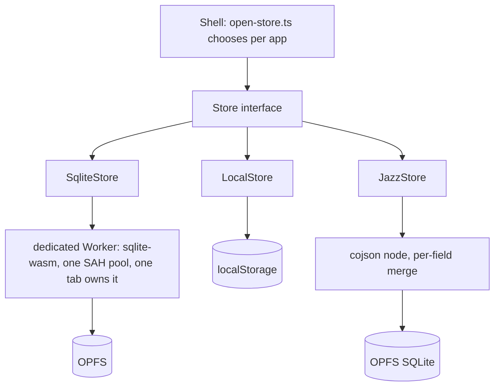
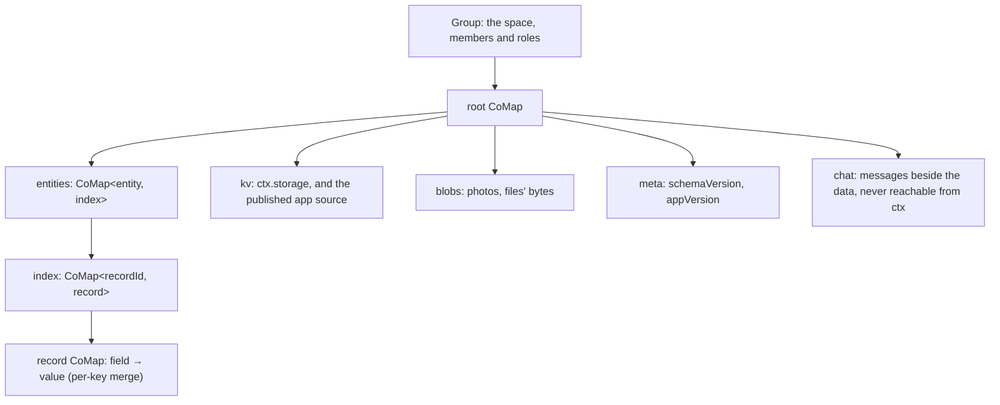

# How Potyro works

This page is for a developer who wants to know what Potyro is made of: someone deciding whether to
use it, or about to work on it. It goes layer by layer, from the app module down to storage and up
to the Studio that writes apps. Each section says what the layer does, how it is built and why it
was built that way, and ends with where the code is. The deeper pages in `docs/` are linked where
they exist; this page is the entry point, not a replacement for them.

Everything here describes the code as it is, not a plan. Where a mechanism is still behind a flag or
not yet done, the text says so.

## On one screen

- **An app is one TypeScript module.** It default-exports `defineApp({...})`. Its data shape
  (entities, fields, pages) is plain data; its logic (computed values, filters, actions, reminders,
  whole custom views) is ordinary functions. No expression language, no visual builder.
- **`ctx` is the only path to host power.** Every function receives `ctx`: data, time, storage,
  files, the person, the UI, navigation and the device's capabilities. Growing Potyro means growing
  `ctx`.
- **Where code runs is decided by where it came from.** Your own app runs direct. An app that
  arrived from anyone else runs sealed: its logic in a Worker inside an opaque-origin sandboxed
  iframe, host power only through the same `ctx`, mediated, with consent prompts and a watchdog.
- **Everything works offline, and nothing leaves the device until you say so.** Records live in
  SQLite over OPFS; sync is opt-in per app and end-to-end encrypted; a person who never syncs never
  loads the sync engine or touches the network.
- **The Studio writes apps with a model, under gates.** A change is edits the host applies, every
  candidate is validated and run before it is accepted, and a fix counts only when the person's own
  recorded case passes against it.

What Potyro is not: not a no-code builder, not a DSL, not a hosted service.

## The one idea

Here is the shape of an app, cut down from `examples/recipes.app.tsx`:

```ts
import { defineApp } from "potyro";

export default defineApp({
  id: "recipes",
  name: "Recipes",
  schemaVersion: 1,
  entities: {
    recipe: {
      label: "Recipe",
      displayField: "name",
      fields: {
        name: { type: "text", required: true, label: "Name" },
        servings: { type: "number", default: 2, min: 1, integer: true, label: "Servings" },
        ingredients: { type: "list", of: { ingredient: { type: "relation", to: "ingredient" }, quantity: { type: "number" } } },
      },
      computed: {
        calories: (r) => r.ingredients.reduce((s, i) => s + i.ingredient.caloriesPer100 * i.quantity / 100, 0),
        caloriesPerServing: { label: "Calories per serving", value: (r) => r.calories / Math.max(r.servings, 1) },
      },
    },
  },
  pages: [
    { id: "all", title: "Recipes", view: { type: "gallery", entity: "recipe", filter: (r, ctx) => matches(r, ctx.params.q) } },
  ],
});
```

Two kinds of thing sit side by side in that object. The **shape** is data: entities, fields, pages
and view layout. The schema package validates it with Zod, and from it the runtime gets storage,
forms, validation and migrations for free. The **logic** is functions: a computed value, a page
filter, an action, a reminder, a custom view written in React. TypeScript types them; nothing
validates them, because arbitrary code cannot be validated, only run somewhere safe.

The decision behind this is the one the project exists for. Every "safe little expression language"
for app logic eventually reinvents variables, conditionals, loops and a bad module system, and
still hits a wall. Potyro refuses the restricted language. The language is unrestricted TypeScript,
with real imports, loops, types and a debugger. What Potyro controls instead are two things that
are independent of the language:

- **The capability surface.** Everything an app can reach is on `ctx`, which the host builds and
  hands to every function. Power is the richness of `ctx`.
- **The execution boundary.** Where the function runs, and with what authority, is the host's
  choice per app. Safety is the boundary.

Power and safety are different axes. The same source runs direct when it is yours and sealed when
it is not, and the code does not know which. The rest of this page is those two axes, layer by layer.



<details><summary>Where in the code</summary>

- `packages/schema/src/defineApp.ts` — `defineApp`: identity, normalisation, the Zod check of the declarative parts
- `packages/schema/src/validate.ts` — the field types and what each accepts
- `packages/schema/src/types/ctx.ts` — the `ctx` surface as types; the Studio's reference for the model is generated from these files
- `examples/recipes.app.tsx` — the first example app
- Deep docs: docs/01 (vision and scope), docs/03 (the definition model), docs/04 (`defineApp` and `ctx`)

</details>

## The package map

The repository is a pnpm workspace. A package is a seam: it exports an interface, and the packages
above it depend on that interface, never on another package's internals. This is also how parallel
work is organised, one package per owner at a time, with the working agreement in `CLAUDE.md`.

In dependency order, lowest first:

| Package | Owns | Depends on |
|---|---|---|
| `packages/schema` (published as `potyro`) | `defineApp`, the `ctx` types, Zod validation of the declarative parts, `potyro pack` | nothing |
| `packages/design` | the designer's tokens, fonts, logo and colour clock; the Lucide icon table | nothing |
| `packages/i18n` | Potyro's own words in the person's language: locale matching, Lingui catalogs, Intl helpers | nothing |
| `packages/identity` | who you are on this device: the account seed, the cached id and name, recovery words, the secret vault | nothing (cojson) |
| `packages/capabilities` | the `Capabilities` interface, the web implementation, the fakes, the conformance suite | schema |
| `packages/store` | the `Store` interface; `MemoryStore`, `LocalStore`, `SqliteStore`, `JazzStore`; migrations, export, packages, the app's folder | schema |
| `packages/rooms` | the rooms relay for multiplayer apps, and its wire protocol | nothing |
| `packages/host` | loading and running an app: the direct runner, the browser realm, the QuickJS fallback, `ctx` construction, capability mediation | schema, store, capabilities, rooms (protocol) |
| `packages/runtime` | the record model, relation resolution, the computed and action runners, the reminder reconciler, JS-predicate queries, React hooks | schema, store, capabilities, host |
| `packages/views` | the view registry, the built-in views, the host for an app's custom views | runtime, schema, i18n, design |
| `packages/generator` | the model backends, the prompt and its generated reference, the corpus, the create/modify/fix loops, Ask, the evals | schema, store, capabilities, host, runtime, i18n |
| `packages/native` | the Capacitor target for Android and iOS: native capability implementations and the native vault | schema, capabilities |
| `packages/share-links` | the share service for demo links: encrypted packages and their preview cards | nothing |
| `packages/ai-relay` | the relay that pays for the free AI allowance with Potyro's key, with caps | nothing |
| `packages/platform-requests` | the relay that files "Potyro lacks this" requests as GitHub issues | nothing |
| `packages/shell` | the product: launcher, navigation, panels, the Studio, trust prompts, import and export, sharing, the composition root, the PWA build | everything above |
| `packages/create-potyro` | `npm create potyro <dir>`: a starter for writing an app outside this repo | nothing |

Beside the packages: `apps/` holds twenty-one real apps, each built as an installable package, which
are the gallery's content and part of the corpus the Studio's model reads; `examples/` holds the six
living fixtures (recipes, plants, places, groceries, split, workout) that the tests and the tutorials
are written against; `docs/tutorials/code` holds the tutorial's code, stage by stage, checked by its
own tests.

Four rules keep the seams honest, and `pnpm lint:boundaries` (`scripts/check-boundaries.mjs`) fails
on the obvious violations:

- Views talk to the runtime API only. They never import the store, the host or the capabilities.
- The runtime depends on the `Store` and `Capabilities` interfaces, never on a concrete
  implementation. The implementations are chosen once, at the composition root in the shell.
- App code reaches host power only through `ctx`. An app module may import `potyro`; it never
  imports a host, store or capabilities package.
- The four servers (`rooms`, `share-links`, `ai-relay`, `platform-requests`) depend on no Potyro
  package. The shell imports only their browser-safe wire formats.



<details><summary>Where in the code</summary>

- `CLAUDE.md` — the working agreement: the seams, the dependency order, the commands
- `pnpm-workspace.yaml` — what is in the workspace
- `scripts/check-boundaries.mjs` — the boundary check behind `pnpm lint:boundaries`
- `packages/*/package.json` — each package's one-line description and its Potyro dependencies

</details>

## An app's life

From a file on disk to a screen on a phone, an app passes through six stages. Every one of them is
the same whether the app is yours or arrived from someone else; only the fourth decides where the
code runs.

1. **Define.** A person, or the Studio's model, writes the module: `defineApp({...})` with its
   entities, pages and functions. The entry file may import the app's own modules and libraries by
   URL (see "Export, import and packages").
2. **Validate.** `defineApp` normalises the declarative parts and checks them with Zod: every field
   has a known type, every relation points at an entity that exists, every page names a view the
   registry has. The functions are typed by TypeScript and otherwise left alone.
3. **Bundle.** In the browser, esbuild-wasm joins the entry, the app's own modules and its libraries
   into one file (`packages/shell/src/app-bundler.ts`). Before esbuild reads a byte of a module or a
   library, the bytes are checked against the app's lock. For a trusted app the imports of `potyro`
   and `react` resolve to the shell's real modules; for a sealed app they resolve to stubs, so Zod
   and React never enter the untrusted bundle.
4. **Load.** The host decides by provenance (`packages/host/src/create-host.ts`). Your own app loads
   as an ES module in the page and runs direct (`direct-host.ts`): the functions are real closures
   and a custom view is a real React component. An app that came from anyone else loads sealed: the
   bundle runs in a Worker inside a sandboxed iframe, and the host talks to it over a MessagePort
   ("Security isolation" below). Either way the result is a `LoadedApp` with the same `call*`
   methods, so nothing above the host knows the difference.
5. **Run.** The runtime (`packages/runtime/src/core.ts`) owns the read path and the write path. It
   resolves records through the store, follows relations, runs computed values, applies a page's
   filter and sort as JavaScript over the rows, runs actions, and reconciles reminders. Every call
   into app code goes through the host, which is what keeps direct and sealed execution uniform.
6. **Render.** The views package (`packages/views/src/registry.ts`) has fourteen built-in views:
   list, gallery, table, detail, calendar, map, steps, checklist, board, timeline, stats, chart,
   aggregate, and custom, which mounts the app's own React component. The shell puts the page in
   its chrome: the launcher, navigation, the panels for data, history, people and the Studio.

### The read path

1. The shell mounts a page. The page names an entity, a view, and a filter and sort that may be
   data or functions.
2. The runtime asks the store for the entity's records, resolves relations, and runs the computed
   values the view needs, through the host, memoised for the pass.
3. The runtime applies the page's filter and sort as JavaScript over the resolved rows, again
   through the host. There is no query planner: at personal scale, thousands of records and not
   millions, a predicate over an in-memory array is simpler and fast enough, and it removes a whole
   class of pushdown and residual logic.
4. The rows reach the view, built-in or the app's own.
5. The runtime subscribes to the entity; a change re-runs the query and the view updates.

### The write path



An action does its work through `ctx`: patch or create records, read the time, reach a capability,
open a sheet. For a sealed app each of those is a message to the host, answered on a ctx whose
capabilities are mediated. After a write the reminder reconciler recomputes the reminders that
depend on the changed record and schedules them through `ctx.caps.notifications` where the device
has them.

<details><summary>Where in the code</summary>

- `packages/schema/src/defineApp.ts` — validate and normalise
- `packages/shell/src/app-bundler.ts` — bundle in the browser; `packages/shell/src/package-modules.ts` resolves modules and libraries against the lock
- `packages/host/src/create-host.ts` — dispatch by provenance; `packages/host/src/direct-host.ts` — the trusted runner; `packages/host/src/realm/` — the sealed runner
- `packages/runtime/src/core.ts` — the read and write paths; `packages/runtime/src/watch.ts` — framework-free subscriptions; `packages/runtime/src/hooks.ts` — the React binding
- `packages/views/src/registry.ts` — the built-in views; `packages/views/src/custom.tsx` — the app's own view
- `packages/shell/src/main.tsx` — the composition root
- Deep docs: docs/04 (the `ctx` surface), docs/05 (the runtime interfaces)

</details>

## Storage

Everything an app keeps goes through one interface, `Store`, and nothing above it knows which
implementation is behind it. The interface is small enough to read in one go:

```ts
interface Store {
  open(appId): Promise<void>; close(): Promise<void>;
  all(entity, narrow?); get(entity, id); byIndex?(entity, field, value);
  insert(entity, data); update(entity, id, patch); delete(entity, id); increment?(…);
  transaction(fn); subscribe(entity, cb);
  putBlob(blob); getBlob(ref); deleteBlob(key); blobHere?(ref);
  listFiles(); getFile(id); setFile(entry); deleteFile(id);
  kvGet(k); kvSet(k, v); kvDelete(k); kvKeys?(prefix);
  storedSchemaVersion(); runMigrations(plan); memberIds?();
}
```

Records, blobs (photos and files' bytes), the app's folder, a key-value area (`ctx.storage`, where
an app keeps its own state), and the schema version. Three implementations exist, and the shell
chooses one per app at the composition root (`packages/shell/src/open-store.ts`):

**SqliteStore over OPFS** is the default. One SQLite database per app, the engine being
`@sqlite.org/sqlite-wasm`. Records are rows of a generic document table: entity, id, a JSON
document of the field values, and the two timestamps, with tables beside it for blobs, kv, files
and meta. A record is read and written as a document, so adding a field is not a schema change in
SQLite, which keeps migrations simple.

The engine runs in a dedicated Web Worker (`packages/store/src/sqlite-worker.ts`), and this is not
an optimisation: the OPFS sync-access-handle API that makes SQLite durable exists only in workers,
in every browser. Before the worker existed, every device silently fell back to a path that
rewrote the whole database into IndexedDB after each write, so ticking a box in a shopping list paid
for the photo library of an unrelated app. In the worker a write costs the write. All of a device's
databases share one handle pool, because a pool per app ran out of handles after a handful of apps.
Writes are committed when they return; a reload the instant after an add never loses it.

**One tab owns the storage** (`packages/store/src/storage-owner.ts`). The pool holds an exclusive
handle on every file it serves, so a second tab of the same origin cannot open the same pool; before
this was handled, two tabs quietly became two diverging copies of the same apps. A Web Lock names
the owner. Another tab is told that Potyro is open elsewhere and offered the take-over: the lock
moves, the old owner closes its databases outside any transaction and lets go of the files. A
SharedWorker cannot host the pool (sync access handles are for dedicated workers only), and routing a
second tab through the first tab's worker would give it the bytes but not the truth, because each
tab keeps its own in-memory model of what is stored.

**LocalStore** is the fallback where the pool cannot be built: Firefox and headless Chrome lack
it. It serialises the app under one key in localStorage and rewrites it after each mutation, which
is fine at personal scale and nowhere else. `MemoryStore` is the same interface in memory, for
tests and the runtime's default.

**JazzStore** is what an app gets when sync is on: the CRDT store, durable on cojson's own OPFS
SQLite file, with per-field merge across devices. The next section is about it. A synced app
cannot fall back to LocalStore, which has no CRDT; rather than silently drop the guarantee the
person switched on, opening fails loudly and the shell says so.



On top of any store sit three things that are the same whichever one is underneath:

- **The app's own folder** (`packages/store/src/file-space.ts`). A store keeps an index of file
  entries and the bytes as blobs; the folder is the rules on top: a path is taken by one file at a
  time, a file's id survives a rename so a `file` field keeps pointing at it, replacing the bytes
  keeps the id and the created time, every write records a digest, and bytes are written before the
  entry that points at them. In a shared app two members can write the same file; the last write
  wins at the file level and what it replaced is kept for a while as an earlier copy, visible in the
  folder and never to the app.
- **History and the Studio's conversation** are stores of their own, under their own namespaces.
  Sources are large and there are many versions of each app; the localStorage budget already
  carries every app's current source, and history is exactly the thing that would push it over.
- **Migrations** (docs/06). An app declares its `schemaVersion` and a list of steps: `addField`,
  `dropField`, `renameField`, `renameEntity`, and `transform`, a function over every record as the
  escape hatch. The steps are applied by one shared, pure function (`packages/store/src/migrate.ts`)
  so every store runs identical semantics, and the test suite for the in-memory store covers the
  logic the SQLite store relies on. The Studio adds a check above this: after a model changes an
  app, every stored value is compared before and after, and a value that disappeared without a
  migration step to account for it is reported as loss ("The Studio and the generator" below).

<details><summary>Where in the code</summary>

- `packages/store/src/types.ts` — the `Store` interface
- `packages/store/src/sqlite-store.ts`, `packages/store/src/sqlite-backend.ts`, `packages/store/src/sqlite-worker.ts`, `packages/store/src/sqlite-worker-client.ts` — SQLite over OPFS in a worker
- `packages/store/src/storage-owner.ts` — one tab owns the pool
- `packages/store/src/local-store.ts`, `packages/store/src/memory-store.ts`, `packages/store/src/idb-sqlite.ts` — the fallbacks
- `packages/store/src/file-space.ts` — the app's folder
- `packages/store/src/migrate.ts` — migration steps, shared by every store
- `packages/shell/src/open-store.ts` — which store an app gets; `packages/shell/src/app-history.ts`, `packages/shell/src/studio-chat.ts` — history and the conversation as their own stores
- Deep doc: docs/06

</details>

## Sync, CRDT and identity

Sync is opt-in per app, never a property of the product. An app that has not asked for it has no
network, no identity engine and no CRDT loaded; one that has lives in a **space**, a group of people
with roles, whose data is a tree of CRDT values encrypted to its members and pushed through a relay
that can read none of it.

### Why Jazz

The engine evaluation (`docs/adr/0001-sync-engine-and-identity.md`) measured Jazz, Yjs and Evolu
against the same apps, with the spikes kept in `docs/spikes/`. Jazz's cojson won on four points:

- **Per-key merge on a document model.** Two people editing different fields of one record both
  survive. Evolu's per-column model needed a storage rewrite to get the same property.
- **A real list CRDT.** Concurrent appends to a nested list field both survive, and three of the
  first four example apps have nested lists.
- **Permissions fail closed in the crypto layer.** A non-member has no read key, so no valid
  transaction exists. It is not a policy check that can be bypassed.
- **Self-hostable, with app data as ciphertext only.** Verified end to end against a real
  `jazz-run sync` server; group and account metadata is visible to the relay, app writes are opaque.

Yjs is the documented fallback: its merge semantics are equivalent and the `Store` shape barely
changes. The ADR keeps the Yjs design on purpose.

### The tree

A record is a CoMap, because that is the only shape in which cojson merges per key. Stored as one
JSON blob inside a CoMap it would collapse to whole-record last-write-wins, the failure that
disqualified Evolu.



Chat sits beside the entity tree. It is in the space, so it syncs and is encrypted to the members,
but it is not app data: an app shared with you is someone else's code, and nothing in `ctx` reaches
the conversation. Messages are ordered by a hybrid logical clock (`packages/store/src/hlc.ts`),
because wall clocks disagree: a device five minutes fast put its replies into everyone's future,
and the conversation read backwards with nothing that looked like a bug. The clock folds every
stamp a device has seen into its own, so a reply can never precede its cause.

A JazzStore write returns only when cojson has written it to storage. That was a real bug: cojson
flushes on its own schedule, and an add followed by an instant reload was gone. A write in the
synced store now means what a write in the SQLite store means.

### Identity

A person is a display name plus a **cojson account**, created silently on first run. No signup, no
email, no identity server. The account id is derived from a secret seed by crypto alone, so minting
an identity needs no database, no node and no network; the account CoValue is materialised lazily,
the first time an app syncs, and the ids agree by construction. A person who never turns on sync
has an identity and has still never loaded the CRDT engine.

The id is for life. Every `createdBy` ever stamped points at it; an id that changed when sync was
turned on would orphan authorship across every shared record. That is also why `createdBy` is the
account id and not a field an app writes: cojson signs every transaction with the account that made
it, so the id is provable, while a value in a field is just data any writer could forge. The host
stamps authorship; app code sees `ctx.me`, `ctx.space.members` with their roles (`admin`, `writer`,
`reader`), and a `member` field type that may only name someone in the space.

The seed and the agent secret are the whole identity, so they live in a vault
(`packages/identity/src/vault.ts`): the platform keystore on Android and iOS, and on the web an
IndexedDB entry encrypted with an AES-GCM key the browser generated as non-extractable. The limit is
stated plainly: code on this origin can still ask that key to decrypt. What the vault removes is the
secret lying in the clear in localStorage, where an extension or a backup tool could read it.

A second device is linked by the seed as recovery words. The words identify you with no lookup, but
the new device still has to load the account, and that arrives through the relay you already sync
through. There is no identity server; there is a transport.

### Two kinds of trust that never merge

Potyro has two orthogonal axes called trust, and collapsing them is the mistake the design guards
against. **Code trust** is provenance: your own app runs direct, anyone else's runs sealed. **Peer
trust** is membership: who may read and write a space. A friend you trust completely can send you an
app, and it still runs sealed. Being invited to someone's data says nothing about whether their code
should run with ambient authority. In fact the sealed box is what makes accepting a friend's app
safe.

### Turning sync on is a copy, not a switch

The local store and the synced store keep their data in different files. Flipping a flag would open
the app empty, which is indistinguishable from data loss. So `packages/shell/src/toggle-sync.ts` is
the only place allowed to do it, and it copies first and flips the flag only when the copy
succeeded. The copy (`packages/store/src/copy-store.ts`) preserves what a naive copy would lose: ids
and creation times, because relations and media references point at them; blob keys, because a
record's photo points at a key and minting a new one loses every photo while appearing to succeed;
the kv area; the app's folder with its ids. Nothing is deleted from the old store, so a migration
that turns out wrong is reversible by flipping back. Bytes that are not on this device are reported,
not copied.

"Back up everything" (`packages/shell/src/backup-all.ts`) is the same mechanism applied to every
app, one at a time with progress, because a new device should bring back every app and not only the
ones someone remembered to tick. It is off until asked for: nothing in Potyro sends data anywhere
until the person says so.

Which apps are yours is kept on your account, not on a device (`packages/store/src/account-apps.ts`):
a map from app id to the space holding its data, the app's code, and roughly how much there is to
fetch, encrypted to your keys and stored on the relay like any other value. A new device signs in,
reads the map, and asks for the spaces it names.

### The relay

The relay is a dumb, encrypted store-and-forward server: an append-only log of opaque update blobs
per space, which it can never decrypt. It is `jazz-run sync` with a SQLite file, run in a container.
Peer-to-peer was considered and rejected as the primary transport, because the use cases are
asynchronous (you add an expense at dinner, your flatmate reconciles on Sunday), a backgrounded phone
app is not a peer, and NAT traversal needs a TURN server, which is a hosted relay by another name.
A solo synced app is a space with one member and no peers: still no network.

### What breaks when an app is shared

Per-field last-write-wins is the right merge, and app code can still be wrong about it. The first
app shared in a public test had two such bugs, neither producing an error (docs/17): reordering by
swapping two rows' `order` values fused them, because a swap is a read-modify-write across two
records and nothing makes that atomic; and a `+1` button that read the count on screen and wrote it
back lost presses when two people pressed at once. Both devices agreed on the wrong answer. The
store answers the second with `increment(entity, id, field, delta)`, which takes the delta and lets
the CRDT sum each contributor; the first is a modelling rule. The Studio runs a two-peer check on
every app it saves (`packages/shell/src/check-concurrency.ts`) and reports what would not survive
two people, without blocking the save, because plenty of apps are never shared.

<details><summary>Where in the code</summary>

- `packages/store/src/jazz-store.ts` — the CRDT store and the tree; `packages/store/src/jazz-backend.ts` — opening it durably, the account, the group, the root, durability on write
- `packages/store/src/hlc.ts` — the hybrid clock; `packages/store/src/people-log.ts` — guests and the people log
- `packages/identity/src/identity.ts`, `packages/identity/src/vault.ts` — the account, the id for life, the secret vault
- `packages/store/src/copy-store.ts`, `packages/shell/src/toggle-sync.ts`, `packages/shell/src/backup-all.ts` — sync as a copy
- `packages/store/src/account-apps.ts` — your apps, on your account
- `packages/shell/src/open-store.ts` — which store, and the live space for `ctx.space`
- `packages/shell/src/check-concurrency.ts`, `packages/store/test/concurrency-hazards.test.ts` — the two-peer check
- Deep docs: `docs/adr/0001-sync-engine-and-identity.md`, docs/17, docs/16 (running the relay)

</details>
