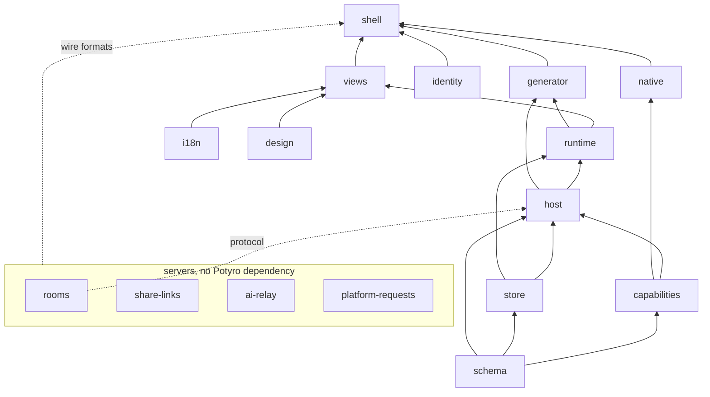

# How Potyro works

This page is for a developer who wants to know what Potyro is made of: someone deciding whether to
use it, or about to work on it. It goes layer by layer, from the app module down to storage and up
to the Studio that writes apps. Each section says what the layer does, how it is built and why it
was built that way, and ends with where the code is. The deeper pages in `docs/` are linked where
they exist; this page is the entry point, not a replacement for them.

Everything here describes the code as it is, not a plan. Where a mechanism is still behind a flag or
not yet done, the text says so.

## On one screen

- **An app is one TypeScript module.** It default-exports `defineApp({...})`. Its data shape
  (entities, fields, pages) is plain data; its logic (computed values, filters, actions, reminders,
  whole custom views) is ordinary functions. No expression language, no visual builder.
- **`ctx` is the only path to host power.** Every function receives `ctx`: data, time, storage,
  files, the person, the UI, navigation and the device's capabilities. Growing Potyro means growing
  `ctx`.
- **Where code runs is decided by where it came from.** Your own app runs direct. An app that
  arrived from anyone else runs sealed: its logic in a Worker inside an opaque-origin sandboxed
  iframe, host power only through the same `ctx`, mediated, with consent prompts and a watchdog.
- **Everything works offline, and nothing leaves the device until you say so.** Records live in
  SQLite over OPFS; sync is opt-in per app and end-to-end encrypted; a person who never syncs never
  loads the sync engine or touches the network.
- **The Studio writes apps with a model, under gates.** A change is edits the host applies, every
  candidate is validated and run before it is accepted, and a fix counts only when the person's own
  recorded case passes against it.

What Potyro is not: not a no-code builder, not a DSL, not a hosted service.

## The one idea

Here is the shape of an app, cut down from `examples/recipes.app.tsx`:

```ts
import { defineApp } from "potyro";

export default defineApp({
  id: "recipes",
  name: "Recipes",
  schemaVersion: 1,
  entities: {
    recipe: {
      label: "Recipe",
      displayField: "name",
      fields: {
        name: { type: "text", required: true, label: "Name" },
        servings: { type: "number", default: 2, min: 1, integer: true, label: "Servings" },
        ingredients: { type: "list", of: { ingredient: { type: "relation", to: "ingredient" }, quantity: { type: "number" } } },
      },
      computed: {
        calories: (r) => r.ingredients.reduce((s, i) => s + i.ingredient.caloriesPer100 * i.quantity / 100, 0),
        caloriesPerServing: { label: "Calories per serving", value: (r) => r.calories / Math.max(r.servings, 1) },
      },
    },
  },
  pages: [
    { id: "all", title: "Recipes", view: { type: "gallery", entity: "recipe", filter: (r, ctx) => matches(r, ctx.params.q) } },
  ],
});
```

Two kinds of thing sit side by side in that object. The **shape** is data: entities, fields, pages
and view layout. The schema package validates it with Zod, and from it the runtime gets storage,
forms, validation and migrations for free. The **logic** is functions: a computed value, a page
filter, an action, a reminder, a custom view written in React. TypeScript types them; nothing
validates them, because arbitrary code cannot be validated, only run somewhere safe.

The decision behind this is the one the project exists for. Every "safe little expression language"
for app logic eventually reinvents variables, conditionals, loops and a bad module system, and
still hits a wall. Potyro refuses the restricted language. The language is unrestricted TypeScript,
with real imports, loops, types and a debugger. What Potyro controls instead are two things that
are independent of the language:

- **The capability surface.** Everything an app can reach is on `ctx`, which the host builds and
  hands to every function. Power is the richness of `ctx`.
- **The execution boundary.** Where the function runs, and with what authority, is the host's
  choice per app. Safety is the boundary.

Power and safety are different axes. The same source runs direct when it is yours and sealed when
it is not, and the code does not know which. The rest of this page is those two axes, layer by layer.


<details><summary>Where in the code</summary>

- `packages/schema/src/defineApp.ts` — `defineApp`: identity, normalisation, the Zod check of the declarative parts
- `packages/schema/src/validate.ts` — the field types and what each accepts
- `packages/schema/src/types/ctx.ts` — the `ctx` surface as types; the Studio's reference for the model is generated from these files
- `examples/recipes.app.tsx` — the first example app
- Deep docs: docs/01 (vision and scope), docs/03 (the definition model), docs/04 (`defineApp` and `ctx`)

</details>

## The package map

The repository is a pnpm workspace. A package is a seam: it exports an interface, and the packages
above it depend on that interface, never on another package's internals. This is also how parallel
work is organised, one package per owner at a time, with the working agreement in `CLAUDE.md`.

In dependency order, lowest first:

| Package | Owns | Depends on |
|---|---|---|
| `packages/schema` (published as `potyro`) | `defineApp`, the `ctx` types, Zod validation of the declarative parts, `potyro pack` | nothing |
| `packages/design` | the designer's tokens, fonts, logo and colour clock; the Lucide icon table | nothing |
| `packages/i18n` | Potyro's own words in the person's language: locale matching, Lingui catalogs, Intl helpers | nothing |
| `packages/identity` | who you are on this device: the account seed, the cached id and name, recovery words, the secret vault | nothing (cojson) |
| `packages/capabilities` | the `Capabilities` interface, the web implementation, the fakes, the conformance suite | schema |
| `packages/store` | the `Store` interface; `MemoryStore`, `LocalStore`, `SqliteStore`, `JazzStore`; migrations, export, packages, the app's folder | schema |
| `packages/rooms` | the rooms relay for multiplayer apps, and its wire protocol | nothing |
| `packages/host` | loading and running an app: the direct runner, the browser realm, the QuickJS fallback, `ctx` construction, capability mediation | schema, store, capabilities, rooms (protocol) |
| `packages/runtime` | the record model, relation resolution, the computed and action runners, the reminder reconciler, JS-predicate queries, React hooks | schema, store, capabilities, host |
| `packages/views` | the view registry, the built-in views, the host for an app's custom views | runtime, schema, i18n, design |
| `packages/generator` | the model backends, the prompt and its generated reference, the corpus, the create/modify/fix loops, Ask, the evals | schema, store, capabilities, host, runtime, i18n |
| `packages/native` | the Capacitor target for Android and iOS: native capability implementations and the native vault | schema, capabilities |
| `packages/share-links` | the share service for demo links: encrypted packages and their preview cards | nothing |
| `packages/ai-relay` | the relay that pays for the free AI allowance with Potyro's key, with caps | nothing |
| `packages/platform-requests` | the relay that files "Potyro lacks this" requests as GitHub issues | nothing |
| `packages/shell` | the product: launcher, navigation, panels, the Studio, trust prompts, import and export, sharing, the composition root, the PWA build | everything above |
| `packages/create-potyro` | `npm create potyro <dir>`: a starter for writing an app outside this repo | nothing |

Beside the packages: `apps/` holds twenty-one real apps, each built as an installable package, which
are the gallery's content and part of the corpus the Studio's model reads; `examples/` holds the six
living fixtures (recipes, plants, places, groceries, split, workout) that the tests and the tutorials
are written against; `docs/tutorials/code` holds the tutorial's code, stage by stage, checked by its
own tests.

Four rules keep the seams honest, and `pnpm lint:boundaries` (`scripts/check-boundaries.mjs`) fails
on the obvious violations:

- Views talk to the runtime API only. They never import the store, the host or the capabilities.
- The runtime depends on the `Store` and `Capabilities` interfaces, never on a concrete
  implementation. The implementations are chosen once, at the composition root in the shell.
- App code reaches host power only through `ctx`. An app module may import `potyro`; it never
  imports a host, store or capabilities package.
- The four servers (`rooms`, `share-links`, `ai-relay`, `platform-requests`) depend on no Potyro
  package. The shell imports only their browser-safe wire formats.



<details><summary>Where in the code</summary>

- `CLAUDE.md` — the working agreement: the seams, the dependency order, the commands
- `pnpm-workspace.yaml` — what is in the workspace
- `scripts/check-boundaries.mjs` — the boundary check behind `pnpm lint:boundaries`
- `packages/*/package.json` — each package's one-line description and its Potyro dependencies

</details>
